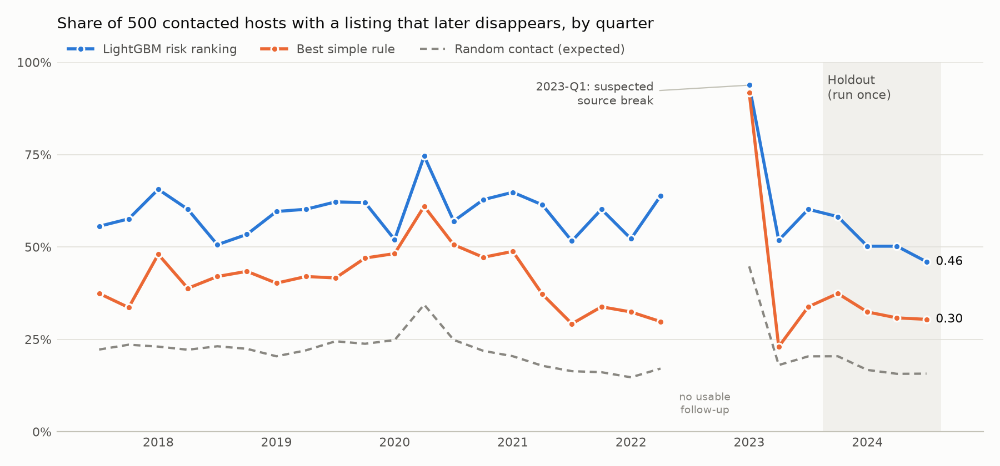

# Prioritizing Hosts at Risk of Losing Listings

*A rolling-backtest evaluation on a decade of public Inside Airbnb snapshots (2015–2026)*

> I built and evaluated a system that prioritizes hosts for investigation based on the risk that their listings
> disappear, while accounting for unreliable snapshots and information availability.

## 1. The decision

A marketplace's supply is its listings, and Airbnb's filings name host retention as a business risk. The decision
studied here: **each quarter, which 500 hosts should a retention team contact first?** Contacting someone costs
money, so the ranking matters more than the raw accuracy of the model.

The project measures **targeting**: whether the hosts it picks are the ones whose listings go on to disappear. It
does **not** measure whether contacting them would keep those listings. That needs an experiment (§6).

## 2. Data

Public scraped snapshots from Inside Airbnb: **6 US markets** (Austin, Denver, Nashville, New Orleans, San Diego, Seattle),
**563 snapshots, May 2015 – Jun 2026, 4.2M listing-snapshot rows**, monthly until 2022 and quarterly after. The source
database and raw files were only ever read, and a fingerprint check confirms they're unchanged.

Validation against the raw files turned up problems in the inherited curated table, all fixed in a derived copy
with every change flagged:

| Problem | Effect | Fix |
|---|---|---|
| Prices ≥ $1,000 parsed only up to the thousands comma | 95,984 prices became 1–15 | re-read from raw |
| Missing values stored as 0 (price, response and acceptance rates) | 2.2M false zeros | NULL |
| Amenity codes `AC1`–`AC82` are positions of hand labels built from all years at once | "waterslide" 96% in 2016 | dropped |
| `zip` actually holds neighbourhood names, mixed with other fields | geography not comparable across years | raw `neighbourhood_cleansed` |
| Snapshot rows collected days after the file date | features could use data from after the decision | all timing uses actual collection dates |
| 166 ids written in scientific notation | listings can't be followed across snapshots | excluded |

## 3. Outcome: "absent at the ~180-day checkpoint, confirmed absent at ~270 days"

A listing present at a quarterly prediction date counts as **`absent_confirmed`** if it's missing from the snapshot nearest
*t* + 180 days **and** from the one nearest *t* + 270 days (±45 days each). The obvious alternative, "never seen again within 180 days",
mislabels listings that appear once and then leave. It also gives monthly-era listings more chances to reappear, which
biases the label by era (5% vs 10% churn, against 21% vs 18% under the checkpoint rule).

Three design choices do the heavy lifting:
- **Unreliable snapshots:** a snapshot whose listing count drops below 75% of its trailing median is flagged. It's then classified as a
  **partial scrape** if most of the missing listings return at the next *unflagged* snapshot, and as a suspected contraction otherwise.
  Resolving a flag does use a later snapshot, but only once that snapshot is available. Until then the flagged snapshot is unusable,
  and every label it could affect stays provisional.
- **Finality:** a label is final only once every snapshot that could still change the checkpoints has arrived and been classified.
  A forward-in-time test feeds in data 15 days at a time and checks that final labels never change.
- **Population:** active listings (a review in the last 365 days, or first observed within 180 days with enough prior coverage),
  excluding listings rated below 4.0 with ≥ 5 reviews. The rules were fixed before any results.

The outcome is a **proxy**. A missing listing id doesn't necessarily mean a host left Airbnb, or that an accommodation stopped operating.

## 4. Method

- **SQL (DuckDB):** builds the observation schedule, checkpoints, labels and 61 features. Every feature uses only snapshots whose
  status was known by the decision date: state at *t*, changes over ~90 and ~365 days with elapsed time explicit, presence
  over the past year, host portfolio, and city and neighbourhood supply.
- **Python:** a rolling-origin backtest with one fold per deployment quarter. Each fold trains on labels final before the quarter,
  fits its preprocessing on that fold's training rows only, early-stops and calibrates on the latest two training quarters, and scores
  the next quarter. Models: four simple rules, logistic regression, and LightGBM.
- **Host level:** listings are scored, and hosts are ranked and deduplicated by the host at *t*. A **hit** is a contacted host with ≥ 1
  listing that's later absent.
- **Contact list:** a **pooled quarterly ranking benchmark**. Each host is ranked on all of its eligible listings that quarter, across markets,
  so up to 24 of 500 contacted hosts per holdout quarter were ranked partly on listings observed after their assigned contact date
  (`reports/post_holdout_audit.md`). A deployable policy needs a shared information cutoff or a sequential selection, and hasn't been evaluated.
- **Holdout:** a shared block, 2023-Q4 to 2024-Q3, run **once**, after all settings were frozen with file hashes
  (`config/analysis_freeze.json`). The code refuses to run it again or to run it with changed files.
- **Checks:** 91 tests, and a mutation runner showing the suite catches 24 deliberate breaks in the SQL.

## 5. Results



| 500 hosts contacted per quarter | Development (23 quarters, 2017–23) | **Holdout (4 quarters, run once)** |
|---|---|---|
| Random contact | 0.22 | 0.17 |
| Best simple rule (low presence over the past year) | 0.43 | 0.33 |
| **LightGBM risk ranking** | **0.61** | **0.51** |
| Lift over the rule | +17.9 pp (23/23 quarters; block-bootstrap 95% CI 13.9–20.8 pp) | **+18.4 pp on average, positive in all 4 quarters (15.6 to 20.8 pp)** |
| Logistic regression | 0.52 | 0.51 |

About **90 more of every 500 contacted hosts** go on to have a listing disappear than with the best rule, in both periods. Holdout
precision is lower than in development, which **coincides with** a lower base rate (17% vs 22%). That hasn't been shown to fully explain
the decline.

**Both trained models outperform the simple rules. LightGBM provides little additional host precision@500 on this holdout**
(0.511 vs 0.508 for logistic regression, and behind it in 2024-Q3), after leading by 0.08 in development. Its advantage remains visible
at a tighter budget: host precision@100 is 0.64 vs 0.49.

**Value.** Each listing gets a transparent value proxy, *V*: 12 months of booking value at its asking price, with bookings estimated from reviews,
under three scenarios for the share of stays that leave a review. It isn't realized revenue. Ranking hosts by expected exposure **Σ p·V** reaches
**0.61 holdout precision vs 0.52** for ranking by value alone, and captures **+11% more estimated disappearing value**, in 4/4
quarters. Risk adds a real but modest gain over "prioritize the biggest accounts". Hosts with 21+ listings supply 56–66% of the captured value.

## 6. From targeting to benefit

Net benefit per quarter = *prevention rate × take rate × captured value − cost per contact × 500*. Under risk × value targeting on
the holdout, outreach breaks even at **$370 per contact** (prevents 5% of disappearances, 10% take rate) up to **$2,200** (20%, 15%).
Hosts are selected using probability-weighted value. Benefit scenarios use the value proxy associated with observed confirmed absences among selected hosts (on average $37.1M per quarter, against $57.6M of predicted exposure for the same hosts). Calibration errors may change which hosts are selected. The prevention rate is unknown.

The proposed test is a **host-randomized experiment**: the top 1,000 hosts per quarter by Σ p·V, split 1:1, stratified by market and
portfolio size, with the same outcome label. In that population the holdout event rate is **47.5%**. Detecting a 10% relative reduction needs
about **1,722 independent hosts per arm**, so about **four recruitment quarters** of 500 new hosts per arm, plus ~9–10 months of follow-up.
Hosts recur across quarters and can be randomized only once. (The frozen business report sized this on the top 500 by risk; the corrected
figure is from the post-holdout audit.)

## 7. What challenged the project

**Jan → Jun 2023.** At every market's Jan 2023 prediction date, 37–50% of listings came out absent, against 13–22% in
neighbouring quarters. Four checks followed:
- **Matched-duration turnover:** high, at the 93rd–97th percentile, but comparable to COVID.
- **Raw/extract id reconciliation:** clean, apart from the scientific-notation ids.
- **Candidate replacements:** 35–49% of the vanished ids have a new id sharing the same host, neighbourhood, room type and capacity, against ≤ 8% in all 473 earlier snapshot pairs.
- **Source documentation:** the data dictionary describes a collection field added in Aug 2022, but it doesn't explain the break.

The cause is **unresolved**, and the event is documented as a *suspected comparability break*. Removing outcomes because their distribution
looks unusual would itself be a choice, so the primary analysis keeps them, and a prespecified sensitivity variant excludes them (with no
retroactive changes before its effective date). Both were frozen and reported. The sensitivity variant reaches the same conclusion on the holdout:
+0.23 over the rule, 4/4 quarters.

## 8. Limitations and next steps
- **The target is a listing id, not an accommodation.** Linking re-created listings under new ids is a separate study, which needs one-to-one
  matches and a reviewed estimate of false links.
- **Value and benefit are scenario estimates.** *V* is a proxy, and no revenue has been saved yet.
- **Probabilities are poorly calibrated on the holdout.** LightGBM's mean absolute gap between average predicted probability and observed
  frequency is **10.5 percentage points**, worst **13.9**, always overpredicting. Reported precision directly evaluates the frozen selections. Recalibration could change the risk × value ranking.
- **The contact policy is a benchmark, not a deployable process** (§4).
- **Scores are predictive associations.** Feature importance doesn't say why hosts leave or what would keep them.

## Reproducing

```bash
python3.12 -m venv .venv && .venv/bin/pip install -r requirements.txt
scripts/reproduce.sh          # extract -> clean -> validate -> labels -> features -> tests -> backtest -> business
```

The holdout is run once and guarded. The results here come from commit `2c3e71f`.
